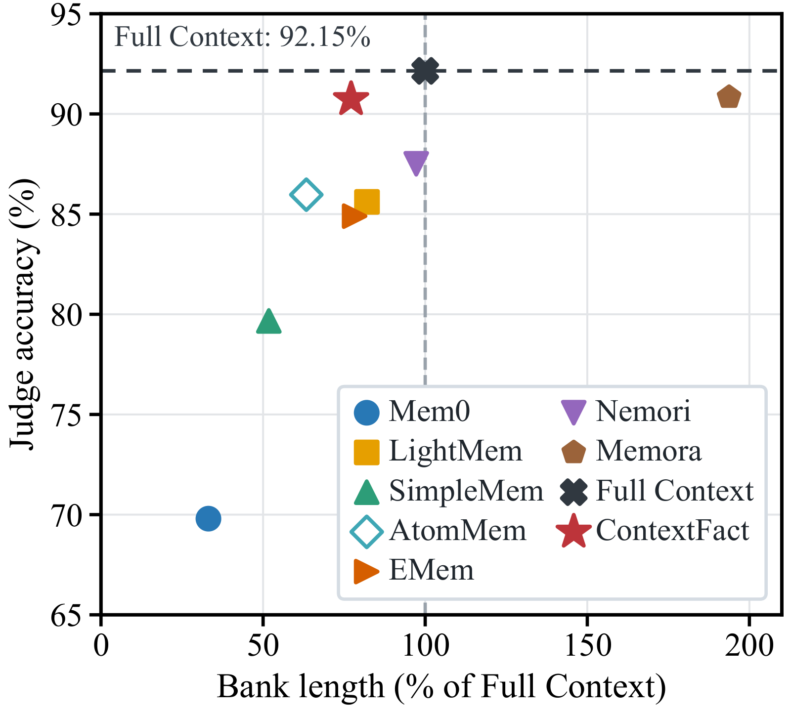
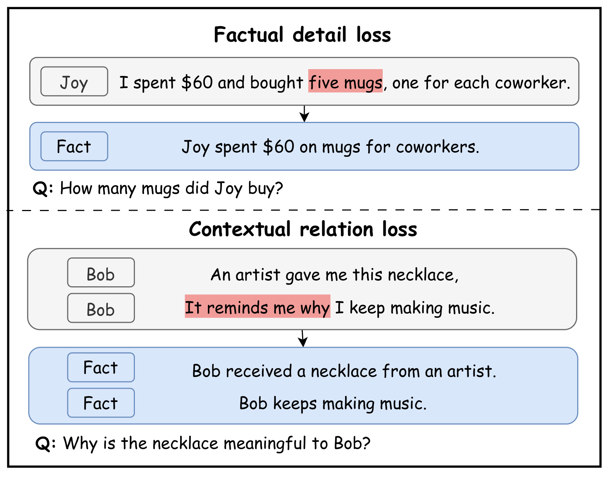
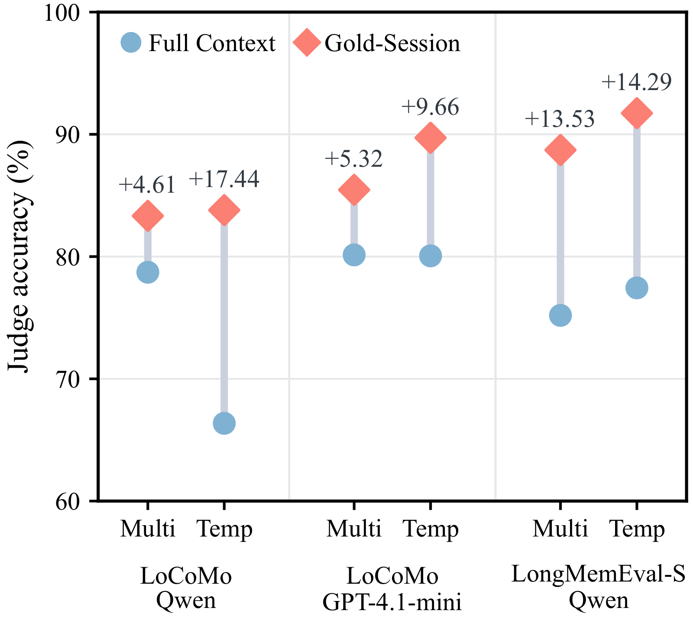
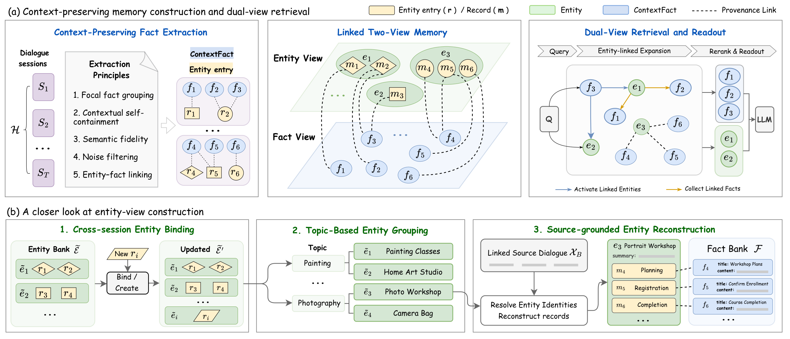
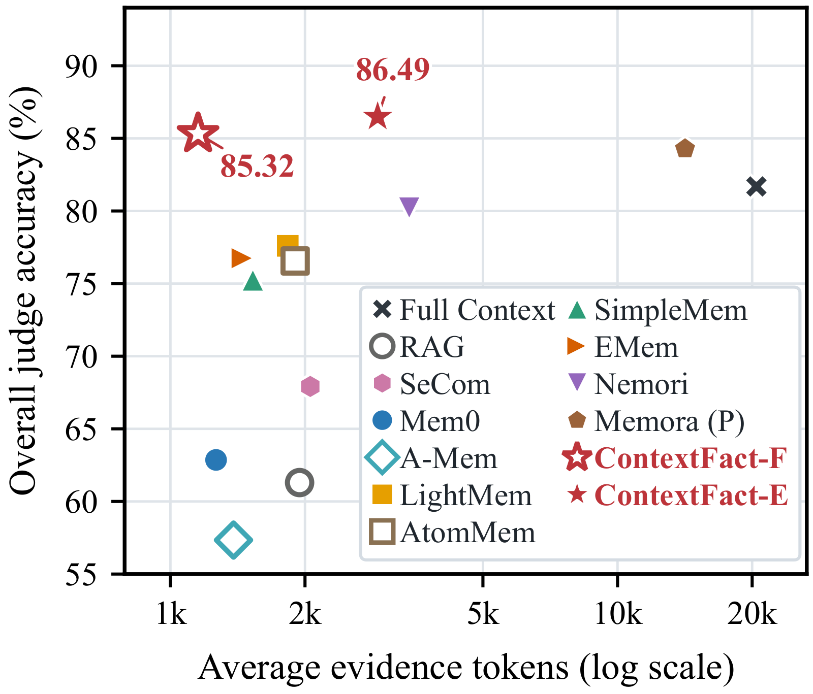
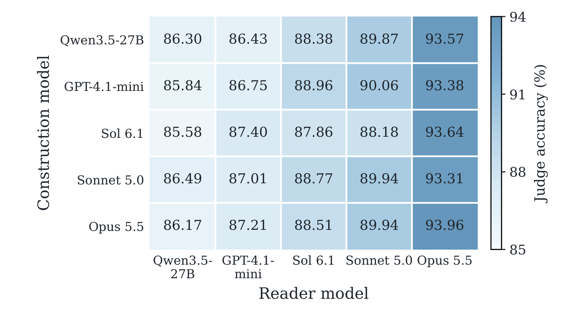

# ContextFact: Remembering Facts in Context for Long-Term Conversational Agents

[](https://www.python.org/)
[](LICENSE)
[](#results)
[](#results)

## Motivation

End-to-end QA scores mix three things: what memory construction preserved, what retrieval selected, and how well the Reader used it. Two controlled diagnostics on LoCoMo pull these apart.

<table>
  <tr>
    <td align="center" width="33%"><br><sub>(a) Single-hop answerability</sub></td>
    <td align="center" width="34%"><br><sub>(b) Construction-time loss</sub></td>
    <td align="center" width="33%"><br><sub>(c) Evidence-scope comparison</sub></td>
  </tr>
</table>

- **Retrieval is not the only bottleneck.** Given each complete memory bank with no retrieval at all, all seven baseline banks still fall below the raw dialogue on single-hop questions (a). Some answers were lost during construction, either by dropping a queried detail or by keeping the statements but losing the relation between them (b).
- **Reading everything is not ideal either.** Keeping only the sessions that contain the evidence beats reading the full history by 4.61–17.44 points on multi-hop and temporal questions (c).
- **Unit boundaries change what is found.** At the same unique-turn budget, retrieving adjacent-turn windows beats single turns on accuracy and gold-turn recall, but wider windows bring no consistent further gain.

**Design principle.** Memory boundaries should follow the dependencies required for interpretation, not a fixed contextual span, while preserving separately retrievable units that can be selectively connected at query time.

## Method

<p align="center">
  
</p>

1. **Context-preserving fact extraction.** For each session, an LLM writes self-contained *ContextFacts (CFs)*. Each CF keeps the turns its fact depends on, and distinct facts stay separately retrievable.
2. **Linked two-view memory.** Across sessions, entity mentions are bound, grouped into a topic directory, and rebuilt from the original turns into *Entities*. Every Entity record links back to its supporting CFs.
3. **Dual-view retrieval.** ContextFact comes in two variants:

| Variant | Memory | Retrieval | Reader input |
|:--|:--|:--|:--|
| **ContextFact-F** | CFs | BM25 + dense RRF → top-30 → rerank | 10 CFs |
| **ContextFact-E** | CFs + Entities | 30 CF + 30 Entity seeds → one-hop expansion through record links → rerank each view | 10 CFs + 10 Entities |

## Results

<p align="center">
  
</p>

<table>
<thead>
<tr><th rowspan="2" align="left">Method</th><th colspan="2">LoCoMo · Qwen3.5-27B</th><th colspan="2">LoCoMo · GPT-4.1-mini</th><th colspan="2">LongMemEval-S · Qwen3.5-27B</th></tr>
<tr><th>J&nbsp;↑</th><th>Tokens&nbsp;↓</th><th>J&nbsp;↑</th><th>Tokens&nbsp;↓</th><th>J&nbsp;↑</th><th>Tokens&nbsp;↓</th></tr>
</thead>
<tbody>
<tr><td><i>Full Context</i></td><td align="center"><i>81.69</i></td><td align="center"><i>20,441</i></td><td align="center"><i>84.03</i></td><td align="center"><i>20,441</i></td><td align="center"><i>83.20</i></td><td align="center"><i>103,726</i></td></tr>
<tr><td>RAG</td><td align="center">61.30</td><td align="center">1,945</td><td align="center">63.90</td><td align="center">1,945</td><td align="center">49.00</td><td align="center">1,965</td></tr>
<tr><td>SeCom</td><td align="center">67.92</td><td align="center">2,055</td><td align="center">71.56</td><td align="center">1,707</td><td align="center">77.80</td><td align="center">6,537</td></tr>
<tr><td>Mem0</td><td align="center">62.86</td><td align="center">1,265</td><td align="center">62.14</td><td align="center">1,408</td><td align="center">76.80</td><td align="center">1,192</td></tr>
<tr><td>LightMem</td><td align="center">77.60</td><td align="center">1,830</td><td align="center">79.61</td><td align="center">2,484</td><td align="center">78.40</td><td align="center">2,896</td></tr>
<tr><td>SimpleMem</td><td align="center">75.26</td><td align="center">1,529</td><td align="center">80.06</td><td align="center">2,016</td><td align="center">76.60</td><td align="center">1,231</td></tr>
<tr><td>EMem</td><td align="center">76.75</td><td align="center">1,449</td><td align="center">79.42</td><td align="center">1,660</td><td align="center">87.20</td><td align="center">1,168</td></tr>
<tr><td>Nemori</td><td align="center">80.19</td><td align="center">3,421</td><td align="center">82.47</td><td align="center">4,662</td><td align="center">81.00</td><td align="center">2,931</td></tr>
<tr><td>Memora (P)</td><td align="center">84.29</td><td align="center">14,156</td><td align="center">85.32</td><td align="center">12,262</td><td align="center">89.20</td><td align="center">13,588</td></tr>
<tr><td><b>ContextFact-F</b></td><td align="center">85.32</td><td align="center"><b>1,153</b></td><td align="center">85.58</td><td align="center"><b>932</b></td><td align="center">87.60</td><td align="center"><b>974</b></td></tr>
<tr><td><b>ContextFact-E</b></td><td align="center"><b>86.49</b></td><td align="center">2,907</td><td align="center"><b>87.27</b></td><td align="center">4,139</td><td align="center"><b>91.00</b></td><td align="center">2,854</td></tr>
</tbody>
</table>

### Transfer across memory representations

Applying the entity construction, retrieval and readout pipeline (+Entity) to SeCom segments, SimpleMem facts and EMem events beats giving each baseline more of its own units at a matched evidence length (+Budget), by 1.10–8.12 points in every system–model combination (LoCoMo).

<table>
<thead>
<tr><th rowspan="2" align="left">Memory bank</th><th colspan="2">Tokens</th><th colspan="3">Multi-hop J</th><th colspan="3">Overall J</th></tr>
<tr><th>+Budget</th><th>+Entity</th><th>+Budget</th><th>+Entity</th><th>Δ</th><th>+Budget</th><th>+Entity</th><th>Δ</th></tr>
</thead>
<tbody>
<tr><td colspan="9" align="center"><i>GPT-4.1-mini</i></td></tr>
<tr><td>SeCom</td><td align="center">5,354</td><td align="center">5,358</td><td align="center">77.30</td><td align="center"><b>80.50</b></td><td align="center">+3.20</td><td align="center">80.58</td><td align="center"><b>84.68</b></td><td align="center">+4.10</td></tr>
<tr><td>SimpleMem</td><td align="center">5,960</td><td align="center">5,930</td><td align="center">78.72</td><td align="center"><b>80.14</b></td><td align="center">+1.42</td><td align="center">83.38</td><td align="center"><b>84.81</b></td><td align="center">+1.43</td></tr>
<tr><td>EMem</td><td align="center">4,040</td><td align="center">4,027</td><td align="center">79.08</td><td align="center"><b>82.62</b></td><td align="center">+3.54</td><td align="center">83.12</td><td align="center"><b>84.22</b></td><td align="center">+1.10</td></tr>
<tr><td colspan="9" align="center"><i>Qwen3.5-27B</i></td></tr>
<tr><td>SeCom</td><td align="center">4,844</td><td align="center">4,872</td><td align="center">71.63</td><td align="center"><b>81.91</b></td><td align="center">+10.28</td><td align="center">77.01</td><td align="center"><b>85.13</b></td><td align="center">+8.12</td></tr>
<tr><td>SimpleMem</td><td align="center">2,968</td><td align="center">2,863</td><td align="center">75.53</td><td align="center"><b>78.37</b></td><td align="center">+2.84</td><td align="center">77.01</td><td align="center"><b>78.38</b></td><td align="center">+1.37</td></tr>
<tr><td>EMem</td><td align="center">3,294</td><td align="center">3,193</td><td align="center">78.37</td><td align="center"><b>81.21</b></td><td align="center">+2.84</td><td align="center">80.32</td><td align="center"><b>82.27</b></td><td align="center">+1.95</td></tr>
</tbody>
</table>

### Construction–reader transfer

Across five construction models and five readers on LoCoMo, ContextFact-E accuracy varies by only 0.7–1.9 points when the construction model changes with the reader fixed, against 6.8–8.1 points when the reader changes with the memory bank fixed. Construction and reader models can be chosen separately.

<p align="center">
  
</p>

<details>
<summary><b>Per-category judge accuracy</b></summary>

**LoCoMo · Qwen3.5-27B** (1,540 questions)

| Method | Single-hop | Temporal | Multi-hop | Open-domain | Overall |
|:--|:-:|:-:|:-:|:-:|:-:|
| *Full Context* | *92.15* | *66.36* | *78.72* | *50.00* | *81.69* |
| RAG | 68.73 | 52.34 | 54.96 | 44.79 | 61.30 |
| SeCom | 77.76 | 55.45 | 60.99 | 43.75 | 67.92 |
| Mem0 | 65.99 | 58.57 | 66.67 | 38.54 | 62.86 |
| A-Mem | 64.21 | 49.22 | 53.19 | 36.46 | 57.34 |
| MemoryOS | 71.82 | 44.24 | 64.89 | 43.75 | 63.05 |
| LightMem | 81.81 | 79.44 | 73.40 | 46.88 | 77.60 |
| AtomMem | 82.16 | 73.52 | 72.70 | 48.96 | 76.56 |
| SimpleMem | 76.69 | 83.49 | 71.63 | 45.83 | 75.26 |
| EMem | 82.40 | 77.26 | 68.44 | 50.00 | 76.75 |
| Nemori | 87.75 | 74.45 | 73.76 | 52.08 | 80.19 |
| Memora (P) | 90.37 | 81.62 | 80.85 | 50.00 | 84.29 |
| **ContextFact-F** | **90.49** | 88.47 | 76.95 | **54.17** | 85.32 |
| **ContextFact-E** | **90.49** | **88.79** | **84.04** | 51.04 | **86.49** |

**LoCoMo · GPT-4.1-mini** (1,540 questions)

| Method | Single-hop | Temporal | Multi-hop | Open-domain | Overall |
|:--|:-:|:-:|:-:|:-:|:-:|
| *Full Context* | *89.77* | *80.06* | *80.14* | *58.33* | *84.03* |
| RAG | 70.04 | 57.32 | 58.51 | 47.92 | 63.90 |
| SeCom | 79.07 | 62.93 | 64.18 | 56.25 | 71.56 |
| Mem0 | 63.85 | 65.11 | 60.64 | 41.67 | 62.14 |
| A-Mem | 75.98 | 70.09 | 54.61 | 37.50 | 68.44 |
| MemoryOS | 79.43 | 55.45 | 70.57 | **64.58** | 71.88 |
| LightMem | 83.95 | 80.69 | 74.47 | 53.12 | 79.61 |
| AtomMem | 82.76 | 74.14 | 74.82 | 53.12 | 77.66 |
| SimpleMem | 86.80 | 78.19 | 72.34 | 50.00 | 80.06 |
| EMem | 84.78 | 77.57 | 74.47 | 53.12 | 79.42 |
| Nemori | 89.54 | 78.50 | 76.95 | 50.00 | 82.47 |
| Memora (P) | 90.73 | 83.49 | 80.14 | 59.38 | 85.32 |
| **ContextFact-F** | 90.37 | 85.67 | 78.37 | **64.58** | 85.58 |
| **ContextFact-E** | **91.44** | **89.72** | **81.56** | 59.38 | **87.27** |

**LongMemEval-S · Qwen3.5-27B** (500 questions)

| Method | Single-User | Single-Asst. | Multi-Session | Temporal | Know.-Update | Single-Pref. | Overall |
|:--|:-:|:-:|:-:|:-:|:-:|:-:|:-:|
| *Full Context* | *94.29* | *98.21* | *75.19* | *77.44* | *91.03* | *70.00* | *83.20* |
| RAG | 77.14 | 92.86 | 24.06 | 28.57 | 60.26 | 73.33 | 49.00 |
| SeCom | 88.57 | **100.00** | 65.41 | 68.42 | 87.18 | 83.33 | 77.80 |
| Mem0 | 94.29 | 14.29 | 78.20 | 82.71 | 91.03 | 83.33 | 76.80 |
| LightMem | 94.29 | 14.29 | 78.95 | 87.97 | 92.31 | 80.00 | 78.40 |
| SimpleMem | 90.00 | 50.00 | 74.44 | 77.44 | 84.62 | 80.00 | 76.60 |
| EMem | 94.29 | **100.00** | 77.44 | 85.71 | 92.31 | 83.33 | 87.20 |
| Nemori | 98.57 | 80.36 | 74.44 | 73.68 | 83.33 | **96.67** | 81.00 |
| Memora (P) | 98.57 | 98.21 | 81.20 | 84.21 | **94.87** | 93.33 | 89.20 |
| **ContextFact-F** | 97.14 | 96.43 | 80.45 | 84.21 | 91.03 | 86.67 | 87.60 |
| **ContextFact-E** | **100.00** | **100.00** | **83.46** | **88.72** | 93.59 | 90.00 | **91.00** |

</details>

## Quick Start

### 1. Install

```bash
pip install -e .        # Python ≥ 3.10
```

### 2. Configure models

```bash
cp .env.example .env
```

Each role takes `*_BASE_URL`, `*_MODEL` and `*_API_KEY`. Any OpenAI-compatible endpoint works, and roles can share an endpoint.

| Role | Prefix | API |
|:--|:--|:--|
| Construction LLM | `LLM_` | `/chat/completions` |
| Reader | `READER_` (defaults to `LLM_`) | `/chat/completions` |
| Judge | `JUDGE_` (model defaults to `gpt-4o-mini`) | `/chat/completions` |
| Embedding | `EMBEDDING_` | `/embeddings` |
| Reranker | `RERANK_` | `/rerank` |

Embedding and reranker models default to Qwen3-Embedding-8B and MemReranker-4B.

**Switching to a CLI subscription.** The construction LLM and the Reader can run through the Codex CLI (ChatGPT subscription) or Claude Code (Claude subscription) instead of an API. Log in to the CLI, then set the backend and model in `.env`:

```bash
LLM_BACKEND=codex             # api (default) | codex | claude
LLM_MODEL=gpt-5.6-luna
READER_BACKEND=claude         # defaults to LLM_BACKEND
READER_MODEL=claude-sonnet-5-5
```

### 3. Run

```bash
# Smoke run: one conversation, 20 questions
python -m contextfact run --conv conv-26 --limit 20 --out runs/smoke

# Full run: builds the memory once, then evaluates ContextFact-F and ContextFact-E
python -m contextfact run --out runs/locomo

# Fullbank: the Reader reads every ContextFact of the conversation, with no retrieval
python -m contextfact run --variant full --out runs/fullbank
```

## Repository Structure

```
contextfact/
├── construction/   # inline dates → ContextFact extraction → entity binding, directory, reconstruction
├── retrieval/      # hybrid search, reranking, ContextFact-F / -E, fullbank
├── evaluation/     # Reader, Judge, metrics
├── prompts/        # prompt templates
├── llm.py          # chat client (API or CLI subscription)
├── cli.py          # Codex / Claude Code subscription backends
└── __main__.py     # command line: run | prepare | build | retrieve | evaluate
```

## Citation

```bibtex
@misc{contextfact2026,
  title  = {{ContextFact}: Remembering Facts in Context for Long-Term Conversational Agents},
  author = {Anonymous Authors},
  note   = {Under review at ICLR 2027},
  year   = {2026}
}
```

## License

The code is released under the [MIT License](LICENSE).
